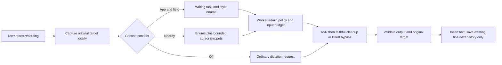

# Automatic dictation context

Implemented November 3, 2026. This is the first implementation of the [research proposal](../research/context-aware-dictation-proposal.md), including bounded cursor context. It is faithful dictation, not a message-writing agent.

## What the user does

Enable **Automatic context** once in Settings on each device and account. Choose **App and field only**, or separately consent to **Nearby text**. After that, the situation is detected when recording starts; there is no chat/email/audience picker during dictation. An optional style preference defaults to Automatic.

Context is off until consent. Turning it off removes context from subsequent uploads, including a pending retry. Switching from Nearby text to App and field only removes snippets and audience clues. Upgrading the app or signing into a different account does not grant context consent for that account.

## Automatic behavior

| Signal | Behavior |
| --- | --- |
| WhatsApp, Messenger, WeChat, Telegram, Signal, Discord | Natural chat cleanup; no assumed recipient relationship |
| Slack, Teams | Clear work messaging |
| Gmail, Outlook, Apple Mail, Thunderbird | Email paragraphs; no invented greeting, subject, or signature |
| Explicit subject, post, comment, or search field hint | Field purpose takes precedence over app category |
| Notes apps | Preserve fragments and ordering |
| Search, literal identifiers, numeric fields, code editors | Bypass prose cleanup |
| Nearby `Dear Professor…`, `Hi Mom…`, `Hello Team…` | A salutation may suggest audience tone, when nearby access is enabled |
| Ambiguous name, quoted greeting, unfamiliar app, unavailable context | Preserve natural tone; no invented relationship |

Classification uses the operating system's editor/app identity and field metadata. App identifiers and field labels stay local. Android and TypeScript use matching pure rules; Mac and admin import the Worker's platform-independent policy. Browser fields without a useful accessible hint may remain unknown. This version does not inspect browser tabs or URLs, read whole conversations, consult contacts, or infer relationships from a person's name.

Known app aliases include package identifiers verified on the connected phone (including Xiaomi Notes) and Apple’s lookup data for [WhatsApp](https://itunes.apple.com/lookup?id=310633997), [Telegram for Mac](https://itunes.apple.com/lookup?id=747648890), and [Telegram Messenger](https://itunes.apple.com/lookup?id=686449807). Unlisted apps fall back conservatively.

## Request and privacy boundary

The optional `options.context` v1 envelope carries purpose, audience clue, source category, style, access level, and optional `before`/`after` text. It never carries app identifiers, field labels, screenshots, contact records, clipboard content, or recipient identity.

Nearby text is limited to 512 UTF-16 code units before and 128 after the selection, with a combined 2,048-byte UTF-8 ceiling. Clients clip at Unicode boundaries. The server rejects invalid enums, extra context keys, oversized snippets, and text supplied under app-only access. Insertion guards keep a local snapshot of the focused field to detect changes; that local snapshot is not the outgoing context payload.

Context is ephemeral. It is absent from history, sync records, activity events, audit records, and request logs. The response contains only a small decision receipt, without snippets. Android bubble retry may keep its original context in memory during the existing one-minute retry window; cancel, target/account changes, and completion clear it. Sensitive/password fields are excluded; Android also respects no-personalized-learning when EditorInfo exposes it and excludes accessibility-data-sensitive fields from context.

## Android

The IME starts bounded InputConnection reads on an IO coroutine when the user starts dictation. Recording does not wait for those reads. At upload, it waits at most 150 ms for a result, falling back to app/field metadata if the editor is slow or unavailable. Reads are tied to the original account and input session and are cancelled when the session ends.

The bubble derives snippets from its existing focused-editor snapshot. It does not add screen traversal for context. Both transports recheck the current privacy setting before upload and authentication retry. Existing session and rich-text insertion checks remain in place.

No new Android manifest, contacts, notification-listener, screenshot, or background microphone permission is added.

## Mac

`native/contextd.m` is a bounded JSON-lines helper, built and packaged beside `tapd`. It keeps an opaque target token and local AX editor snapshot in memory. It checks the app, focused AX element, window when exposed, selection, and exact original text before paste. Secure fields and editors without the required accessible value/range fail safely with a useful message. AX calls have a short messaging timeout and the parent enforces a 2.5-second request deadline.

The dictation state machine correlates renderer audio with a generation ID, accepts one capture per recording, and rejects late results after cancel, timeout, a newer recording, or an account change. The target is checked again after the clipboard settles and immediately before the paste keystroke. This narrows the ordinary macOS paste race; it is not an OS-level atomic edit. Clipboard paste also cannot prove that every application accepted the text.

## Worker and admin

**AI workspace → Automatic context** provides two revisioned switches:

- `context.enabled`: ignore all incoming context when false.
- `context.allowNearbyText`: strip snippets and audience clues when false, retaining the app/field task and style.

Both default true at the server, while client consent defaults off. Existing requests without context behave as before. Existing schema-v1 configurations missing the new section normalize to these defaults; no database migration, new binding, or secret is required. Saving a draft does not publish it.

The test workspace can supply invented context and shows the applied decision. It does not expose real users' editor data. Use it to compare the actual model before publishing a configuration.

The Worker composes fixed task instructions and puts cursor snippets in a separately labelled, JSON-encoded untrusted-data block. It instructs cleanup to preserve meaning, names, numbers, uncertainty, and negation, and never copy reference text. Optional snippets are dropped first, then the context instructions if necessary, to fit the existing 8 KB cleanup input budget. Quota ceilings and maximum output tokens are unchanged; literal fields skip cleanup reservation and inference.

Output checks additionally protect negation/modality and glossary terms. A narrow equivalence rule allows short grammar repairs such as `i has went` → `I have gone.` without generally relaxing rewrite limits. These checks reduce error; they cannot prove semantic equivalence or make an LLM immune to malicious reference text.

## Validation and remaining limits

- 62 Android/shared JVM tests passed; debug assembly and lint passed (zero lint errors).
- Eleven connected-phone checks passed on the user’s Xiaomi phone (Android 17), including synthetic context consent/downgrade, sensitive-field exclusion, target changes, rich-text preservation, and existing insertion regressions.
- 92 Worker unit/integration tests passed for old clients/revisions, byte budgets, hostile reference text separation, admin switches, literal bypass, grammar and meaning checks, and absence of context in stored activity/audit data.
- Eight admin UI tests passed, plus browser verification of the new section and synthetic context receipt.
- Forty Mac tests passed, plus type checks, lint (zero errors; existing and formatting warnings remain), renderer/main build, and native compilation. An AppKit fixture checked AX capture, unchanged-target validation, changed-editor rejection, and secure-field exclusion using an injected fixture app (the test runner takes foreground focus). The production foreground check was also exercised in its fail-closed path.

Live microphone-to-model-to-insertion testing across WhatsApp, Messenger, WeChat, browser editors, and different macOS applications remains a release acceptance step. Automated model tests use fake inference and are not evidence of tone quality. A staging model evaluation should include requests, negation, uncertainty, names, numbers, misleading salutations, prompt injection, and unfamiliar editors. Do not promise every editor or every relationship can be recognized.

This implementation does not create recipient profiles, learn from private conversation histories, add screenshots/OCR, store context in Vectorize, use queues for raw context, or generate additional message content. Those larger proposal phases require separate product decisions and evaluation.

Production deployment, publication of an AI revision, and Android/Mac release are separate from this implementation. No production configuration is changed by building or testing it.
